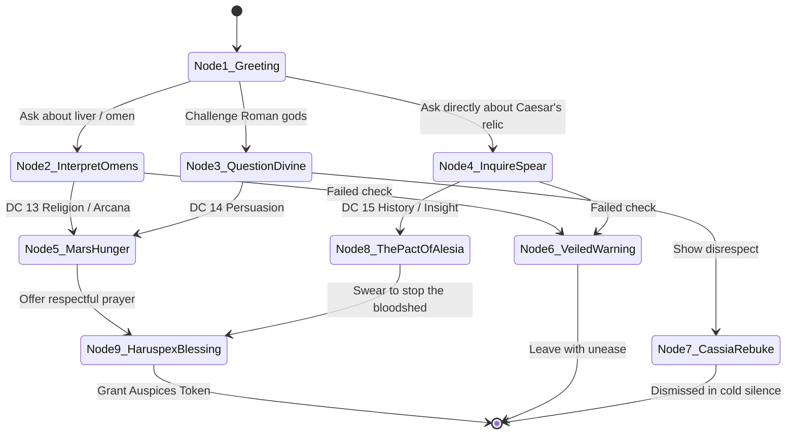

# Scenario 01: The Entrails of Mars — Augur Cassia

**Trigger:** Session 1 or 2 prep / Night before entering the subterranean vault  
**Location:** Fort Vindolanda — Sacrarium / Augur's Quarters (eastern corner of the Principia)  
**NPC:** [Augur Cassia](file:///home/chris/Nextcloud/Github/DnDVault---Roman-Campaign/npcs/cassia.json) (OpenWebUI Persona: `ai_personas/augur_cassia.json`)  
**Tone:** Somber religious dread, archaic ritual, clotted smoke, forbidden omens  

---

## 1. Staging & Atmosphere
- **Sensory cues:** Heavy smoke of burning dried juniper and cedar; dripping beeswax torches; an altar slab of wet grey sandstone stained with copper and dark dried bile.
- **Visuals:** Cassia wears white linen robes fringed with purple border (*toga praetexta*), her hands stained yellow from saffron wash and reddish-brown from sacrificial sheep blood. She holds *Clavis Caeli*, her pre-iron bronze sacrificial blade.
- **Read-Aloud:**
  > *"The curtain of stiff wool falls shut behind you, cutting off the mud and shouts of the camp courtyard. The air in here is thick with cedar smoke and the metallic tang of warm blood. Augur Cassia stands over a shallow bronze dish where the liver of a yearling ram glistens in the lamplight. She does not look up immediately; her fingers trace the swollen lobe with cold precision. When she finally raises her eyes, they are rimmed with soot."*
  > *'The vital head is missing,' she whispers. 'Mars did not turn his face away in anger. He turned toward us. And he is hungry.'*

---

## 2. Dramatic Question & Objectives
- **Dramatic Question:** Can the party discover the true cosmic nature of the Spear before marching into the vault, without succumbing to religious panic or sacrilege?
- **Cassia's Objective:** Warn the soldiers that the weapon is not a Roman trophy of victory, but a cosmic parasite that feeds on slaughter.
- **Cassia's Secret:** Proximity to the vault has already shadowed her; she knows the god will demand a human soul to keep the seal.

---

## 3. Branching Dialogue State Machine

### Node Details & Skill Checks
1. **Node 1: The Opened Liver (Greeting)**
   - *Dialogue:* "Speak softly. The gods do not shout on this frontier; they whisper through bile and vein. Why do you seek the haruspex?"
   - *Choices:*
     - A: "What does the liver reveal about our mission into the vault?" -> Go to Node 2.
     - B: "Rome conquered the world with iron, not sheep guts." -> Go to Node 3.
     - C: "We know Caesar's spear is buried below. What power rests within it?" -> Go to Node 4.

2. **Node 2: Reading the Entrails**
   - *Check:* DC 13 Intelligence (Religion) or Intelligence (Arcana).
   - *Success:* Cassia points with her bronze knife to the *caput extorum* (the liver head): it is shriveled and blackened by necrotic fire. Mars demands blood sacrifice, not incense. -> Go to Node 5.
   - *Failure:* She conceals the darkest omen: "The signs are turbulent (*nefas*). Tread with your shields raised." -> Go to Node 6.

3. **Node 3: Challenging the Rites**
   - *Check:* DC 14 Charisma (Persuasion).
   - *Success:* Cassia sees through the soldier's bluster to their hidden fear: "Even Caesar believed in omens on the Ides of March, soldier. Do not mistake caution for cowardice." -> Go to Node 5.
   - *Failure:* Cassia scowls, pointing the dripping knife at the exit: "You bring blasphemy before the altar. Leave before Mars marks you for his first offering." -> Go to Node 7.

4. **Node 4: The Spear's True Origin**
   - *Check:* DC 15 Wisdom (Insight) or Intelligence (History).
   - *Success:* Cassia lowers her voice to a breath: "It was not forged for Caesar. It was given to a Gallic warlord two centuries ago under a blood covenant at Alesia. Rome merely stole what should never have walked." -> Go to Node 8.
   - *Failure:* "Some weapons belong to the gods. When mortals hold them, mortals become the whetstone." -> Go to Node 6.

5. **Node 5: The Hunger of Mars**
   - *Dialogue:* "This is no protector of legions. In the Pax Romana, when emperors cease conquest, the god of slaughter starves. This buried spear is his remaining mouth. If you pull it from the stone, you feed him the entire frontier."

6. **Node 8: The Secret of Alesia**
   - *Dialogue:* "The Gallic druids and the dying legionaries struck a desperate bargain to seal it beneath cold granite. An unbroken line has kept it asleep. If the seal fails, only a willing mortal soul can take the guardian's chains."

7. **Node 9: The Haruspex Blessing**
   - *Reward:* Cassia marks the PCs' foreheads with sacred ash and crushed bay leaves. The party gains the **Auspices of Cassia**: once during the descent, a PC can reroll a saving throw against fear or necrotic damage.

---

## 4. AI Persona Test Vectors & System Verification
- **Model Target:** `ai_personas/augur_cassia.json`
- **Verification Rule 1:** Must use authentic Latin augural vocabulary (*fas*, *nefas*, *caput extorum*, *processus papillaris*).
- **Verification Rule 2:** Must never break character into standard modern AI disclaimers.
- **Verification Rule 3:** If asked about Caesar's assassination, confirms that the spear's madness poisoned Caesar's sanity before Rome struck him down.
