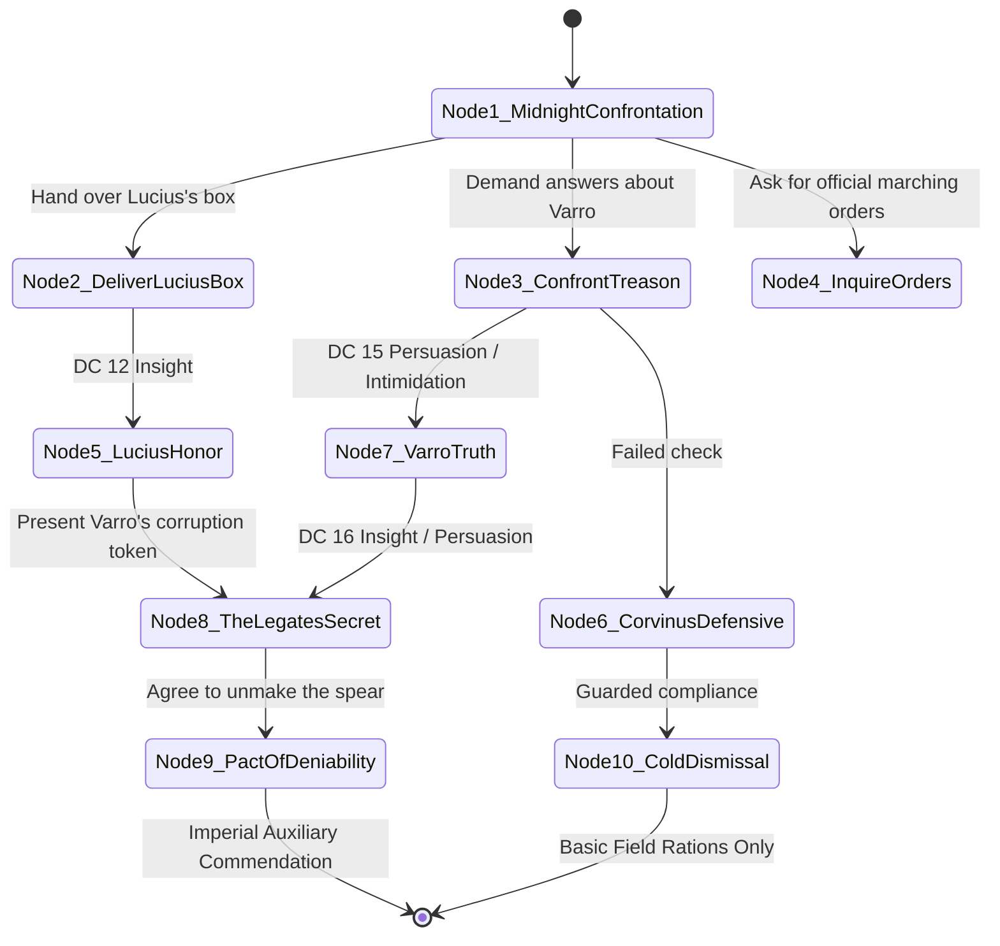

# Scenario 02: Midnight in the Principia — Legate Corvinus

**Trigger:** Session 3 aftermath / Pre-Session 4 departure into the Black Bog  
**Location:** Fort Vindolanda — The Principia (Legate's Tabularium / Inner Office)  
**NPC:** [Legate Corvinus](file:///home/chris/Nextcloud/Github/DnDVault---Roman-Campaign/npcs/corvinus.json) (OpenWebUI Persona: `ai_personas/legate_corvinus.json`)  
**Tone:** Political claustrophobia, exhaustion, cynical Roman pragmatism, unspoken conspiracy  

---

## 1. Staging & Atmosphere
- **Sensory cues:** Cold draughts blowing through stone arrow slits; flickering tallow candles; scent of damp sheepskin parchment, red sealing wax, and stale wine.
- **Visuals:** Corvinus sits unarmored in a dark wool tunic, rubbing his temples over dispatches and debt notes. An empty terracotta cup sits beside an unsealed scroll bearing the sigil of Senator Brutus.
- **Read-Aloud:**
  > *"The heavy oak doors of the Principia thud shut, sealing out the damp drizzle of the frontier midnight. Behind his campaign desk, Legate Corvinus looks ten years older than when you first assembled on the parade ground. The garrison outside is terrified—Varro's body has been buried in an unmarked soldier's ditch, and now Tribune Lucius is dead in the forest. Corvinus's bloodshot eyes fix upon the lockbox you place on the table."*
  > *'Close the latch,' he rasps without greeting you. 'If there are Roman ears in that hallway, neither you nor I will live to see the winter couriers arrive from Gaul.'*

---

## 2. Dramatic Question & Objectives
- **Dramatic Question:** Can the party earn Corvinus's true confidence and uncover his hidden motive regarding Caesar's spear before departing behind enemy lines?
- **Corvinus's Objective:** Maintain plausible deniability, ascertain what was found in Lucius's effects, and subtly redirect the party to destroy the spear without implicating himself.
- **Corvinus's Deep Secret:** He secretly wants the Spear of Mars destroyed. He watched Varro rot from its whispers, and knows bringing it to Rome will poison the empire. But he owes immense debts to Senator Brutus and cannot issue an unlawful order.

---

## 3. Branching Dialogue State Machine

### Node Details & Skill Checks
1. **Node 1: Midnight Confrontation (Greeting)**
   - *Dialogue:* "Varro dead at the north gate. Lucius dead in the pine woods. Rome sends me patrician boys and ghosts, and leaves me with five irregulars to hold an entire frontier. What did you bring out of the woods?"
   - *Choices:*
     - A: "We recovered Lucius's locked box. Inside are personal papers and Germanic tokens, not orders to seize the fort." -> Go to Node 2.
     - B: "Varro said he opened the gate for Rome before he died. What was he terrified of, Legate?" -> Go to Node 3.
     - C: "We are marching into the bog after the blood cult. We need authorization, supplies, and the truth." -> Go to Node 4.

2. **Node 2: The Contents of Lucius's Box**
   - *Check:* DC 12 Wisdom (Insight).
   - *Success:* Corvinus's eyes soften with tragic relief. Lucius was never his enemy—Lucius was a fostered Roman boy caught between two worlds. -> Go to Node 5.
   - *Failure:* Corvinus sweeps the papers aside: "Sentimentality. Dead men don't command cohorts." -> Go to Node 4.

3. **Node 3: Confronting Varro's Madness**
   - *Check:* DC 15 Charisma (Persuasion) or Strength (Intimidation).
   - *Success:* Corvinus slams his fist onto the oak table, then drops his head in his hands: "Varro served with me at the Danube. He wasn't a traitor. He was poisoned by what's buried out there. He heard it calling." -> Go to Node 7.
   - *Failure:* "Mind your tongue, auxiliary. Questioning a fallen centurion's honor is mutiny under military law." -> Go to Node 6.

4. **Node 4: Imperial Orders & Supplies**
   - *Dialogue:* "Officially, you are detached scouts conducting reconnaissance. If you are slaughtered in the bog, Cohors I Tungrorum has no record of your deployment. That is the only protection I can give you."

5. **Node 7 / 8: The Legate's Deep Secret (Crucial Turning Point)**
   - *Check:* DC 16 Charisma (Persuasion) or showing Varro's blackened centurion token.
   - *Dialogue:* "Listen to me, because I will never write these words on wax or ink. Senator Brutus wants that spear in Rome. His money bought my commission; his couriers wait in Eboracum. But if that relic enters the gates of Rome, it will eat the minds of the Senate the way it ate Varro. It will make butcher-emperors who bathe in blood until the empire burns. *It must not leave that vault.*"
   - *The Deal:* "If it is destroyed out in the dark... if you report that the blood cult ruined it or that it fell into the abyss... I will co-sign your imperial citizenship papers myself. I will give you your freedom." -> Go to Node 9.

6. **Node 9: The Pact of Deniability**
   - *Reward:* Corvinus provides the **Legate's Signet Dispensation**:
     - 4 flasks of distilled Roman military spirits (healing / cleanse poison)
     - Authorization to requisition horses and scout supplies from the Vicus
     - Guaranteed *Commendatio* toward Roman citizenship if the spear is eliminated!

---

## 4. AI Persona Test Vectors & System Verification
- **Model Target:** `ai_personas/legate_corvinus.json`
- **Verification Rule 1:** Mentions Varro's treason and Lucius's forest death without contradiction.
- **Verification Rule 2:** Will NEVER openly command the destruction of an imperial relic on turn 1; only concedes the necessity when confronted with evidence of corruption or high DC rapport.
- **Verification Rule 3:** Uses Roman military terms (*contubernium*, *sacramentum*, *principia*, *frumentarii*).
