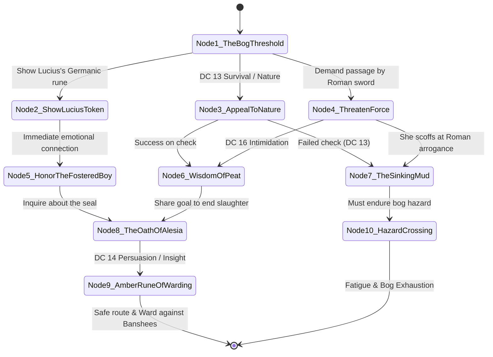

# Scenario 03: The Will-o'-the-Wisp Passage — Thusnelda the Bog Seer

**Trigger:** Session 4 Opening / Scene 1-2 crossing into the Black Bog  
**Location:** The Black Bog — The Sunken Peat Island (3 miles north of Fort Vindolanda)  
**NPC:** [Thusnelda](file:///home/chris/Nextcloud/Github/DnDVault---Roman-Campaign/npcs/thusnelda.json) (OpenWebUI Persona: `ai_personas/thusnelda_seer.json`)  
**Tone:** Folk horror, damp primordial fog, ancient pagan sorrow, natural magic  

---

## 1. Staging & Atmosphere
- **Sensory cues:** Sickly sweet stench of rotting peat moss and stagnant marsh pools; pale blue will-o'-the-wisps dancing on the black water; chilling mist curling around bare ankles.
- **Visuals:** Thusnelda stands on a wicker platform woven between two dead, lichen-hung alder trees. She is wrapped in a peat-stained wool mantle fastened with a raw amber brooch. Her feet are caked in black bog clay.
- **Read-Aloud:**
  > *"The firm earth gives way to spongy, sucking peat. Pale marsh gas flutters in sickly blue flames across pools of black stagnant water. Ahead, where two twisted alders reach like drowned fingers into the fog, a lone woman watches your contubernium approach. She holds a bundle of dried wild thyme and alder bark, smoking softly without flame. As your boots sink into the moss, she speaks without turning around."*
  > *'Another squad of Roman iron come to feed the bog,' her voice cuts through the mist. 'Three paces to your left, a centurion's war-horse sank eighty winters ago. The mud still remembers the taste of his gilded bridle. Why should I show you the dry stone?'"*

---

## 2. Dramatic Question & Objectives
- **Dramatic Question:** Can the party convince Thusnelda that they are not mere imperial looters, but souls committed to putting an end to the spear's endless cycle of blood?
- **Thusnelda's Objective:** Guard the ancient seal of her lineage; test the travelers' spirit; ensure the blood cult under Boduognatus does not awaken the sleeping god.
- **Thusnelda's Secret:** She holds the amber warded path to the Sunken Armory. She also knows that destroying the spear will require a living soul to assume the chains of guardianship.

---

## 3. Branching Dialogue State Machine

### Node Details & Skill Checks
1. **Node 1: The Bog Threshold (Greeting)**
   - *Dialogue:* "The bogs do not care about your Caesar, soldier. Three hundred yards ahead, the marsh churns with three banshees—Roman captives who died crying for mothers whose names the earth forgot. What makes you think you will cross?"
   - *Choices:*
     - A: "We carry a token from Tribune Lucius. He died in the forest, but he carried the songs of your people in his heart." -> Go to Node 2.
     - B: "We know this land is sacred. We come not to conquer, but to stop the cult that defiles the marsh." -> Go to Node 3.
     - C: "Stand aside, witch. We carry steel and legionary orders." -> Go to Node 4.

2. **Node 2: The Memory of Tribune Lucius**
   - *Reaction:* Thusnelda freezes. When shown the amber carved horse from Lucius's box, her gaze softens: "The boy who had two mothers... One of Rome, one of the Rhine. He was too gentle for his father's armor. If you honored his bones, the bog will not drink you today." -> Go to Node 5.

3. **Node 3: Appealing to Nature & the Land**
   - *Check:* DC 13 Wisdom (Survival) or Intelligence (Nature).
   - *Success:* You recognize the medicinal alder bark and step onto the hidden granite stepping stones under the moss. Thusnelda nods: "You look at the earth with eyes, not iron boots." -> Go to Node 6.
   - *Failure:* You step into false peat; your boots sink to the knees in freezing black slurry. -> Go to Node 7.

4. **Node 4: Threatening with Iron**
   - *Check:* DC 16 Strength (Intimidation).
   - *Failure:* Thusnelda laughs like a croaking raven and steps backward into the mist. Wisps flare around you, disorienting the party. -> Go to Node 7.

5. **Node 8: The Oath of Alesia**
   - *Lore:* "Two hundred years ago, after the walls of Alesia burned, my teacher's teacher and the last priests of the Arverni took the spear from the battlefield. Caesar thought he had won; he did not know the spear drove him mad. They bound it beneath the granite with cold silver and ash-wood stakes. But the blood cult has dug beneath the swamp. They slit throat after throat to wake it."

6. **Node 9: The Amber Rune of Warding**
   - *Reward:* Thusnelda gifts the party the **Amber Rune of the Peat-Womb**:
     - Reveals the hidden gravel causeway to the Sunken Armory (Scene 1 of Chapter 4).
     - Grants advantage on saving throws against the **Banshee's Wail** (CR 4) in Scene 1!
     - Forewarns the party that unmaking the spear requires someone to take the guardian's chains.

---

## 4. AI Persona Test Vectors & System Verification
- **Model Target:** `ai_personas/thusnelda_seer.json`
- **Verification Rule 1:** Speaks in rhythmic nature metaphors (mud, peat, will-o'-the-wisps, crows).
- **Verification Rule 2:** Recognizes Lucius's fosterage on the Rhine and expresses genuine grief for his death.
- **Verification Rule 3:** Discloses the druidic binding at Alesia and warns about the price of the altar chains.
