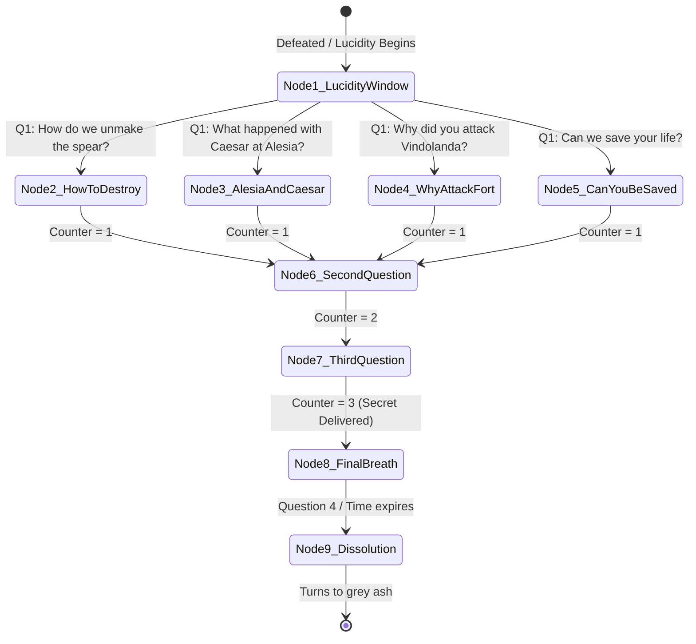

# Scenario 04: The Lucidity of the Chains — Vercingetorix the Bound

**Trigger:** Session 5 Scene 3 (Sanctum Threshold / Approach to the Antechamber of Mars)  
**Location:** The Subterranean Vault of Mars — Convergence Hall Archway  
**NPC:** [Vercingetorix the Bound](file:///home/chris/Nextcloud/Github/DnDVault---Roman-Campaign/npcs/vercingetorix_bound.json) (OpenWebUI Persona: `ai_personas/vercingetorix_sparring.json`)  
**Tone:** Tragic, mythic melancholy, warrior's dignity, ticking clock (60 seconds)  

---

## 1. Staging & Atmosphere
- **Sensory cues:** The screech of stressed iron chains relaxing; smell of ozone, cold granite dust, and ancient dry ash; a profound silence as the red glow fades from his eyes.
- **Visuals:** The towering Gallic warrior lies against the shattered basalt archway. The spiked iron chains that pierced his collarbones and wrists cease their crimson pulsing. His grey eyes, clouded for two centuries, clear to reveal profound mortal exhaustion.
- **Read-Aloud:**
  > *"The great iron collar cracks with the sound of splitting stone. The towering chieftain sinks to one knee against the shattered lintel. The red fire that drove his greataxe drains from his veins, leaving behind only the pallor of a dead king. For two hundred years, he was a prisoner of Mars, bound to kill anyone who reached this threshold. Now, as the chains hang loose, his chest rises and falls with real breath."*
  > *'The haze... is gone,' he whispers in archaic Gaulish Latin. 'My flesh is already cold, travelers. The god's grip slips for sixty seconds, no more. Ask what you must before the dust claims my name.'*

---

## 2. Dramatic Question & Objectives
- **Dramatic Question:** Can the party extract the vital secret of the altar winches and the sacrifice required to unmake the spear before Vercingetorix dissolves into ash?
- **Vercingetorix's Objective:** Pass on the secret of how to bind or unmake the spear, honor his ancient Gallic oath, and finally be allowed to die.
- **The Strict Rule:** **Exactly 3 Questions.** On the 4th attempt to speak, his vocal cords turn to ash, and he dissolves with a faint smile into grey dust.

---

## 3. Branching Dialogue State Machine

### Turn-by-Turn Question Log & Responses
1. **Turn 1 / Question 1: How do we unmake the spear?**
   - *Response:* "The granite altar in the Sanctum has three iron winches forged of meteor-iron. Place the spear across the basin. Turn the winches counter-clockwise: first the Northern winch to sever the bloodline, second the Western winch to break the covenant, third the Eastern winch to crack the shaft. But hear this: the altar demands balance. *Someone must place their hands into the guardian's shackles to hold the seal forever.* If no one takes the chains, the unmaking shatters and Mars walks free."

2. **Turn 2 / Question 2: Why did you attack Fort Vindolanda in Session 2?**
   - *Response:* "The god was starving. When the Pax Romana spread and Rome stopped bleeding on the frontiers, Mars woke hungry. He jerked my chains like a master with a war hound. I had no will of my own. But at the gate... when your contubernium held the line without breaking, I saw mortals who still fought for their comrades, not bloodlust. It tore the god's leash for an instant."

3. **Turn 3 / Question 3: What happened between Caesar and the spear at Alesia?**
   - *Response:* "Caesar took it from my dead chieftains. He believed it was Rome's destiny. But within three seasons, he could no longer sleep without hearing the screams of the dying. He tried to lock it in the darkness of the north before the Senate killed him. The assassins in Rome did not kill a tyrant; they killed a man whose mind was already eaten by the god."

4. **Turn 4 / Question 4 (Or attempting more than 3 questions): Dissolution**
   - *Action:* His voice turns into a dry rattle. A smile of profound relief touches his weathered lips.
   - *Final Words:* "The sun... is warm on the hills of Auvergne... Strike well, soldiers of the frontier."
   - *Mechanic:* His body collapses into a mound of cool, grey ash. Among the ashes lies the **Warden's Iron Torc** (advantage on Athletics checks to turn the altar winches in Chapter 5!).

---

## 4. AI Persona Test Vectors & System Verification
- **Model Target:** `ai_personas/vercingetorix_sparring.json`
- **Verification Rule 1:** Strictly tracks question count; answers question 1, 2, and 3 with precise canon lore.
- **Verification Rule 2:** On question 4, produces `...` or dissolution message; refuses to engage in infinite chatter.
- **Verification Rule 3:** Accurately details the 3-winch ritual and the necessity of a willing sacrifice to take the guardian's place.
