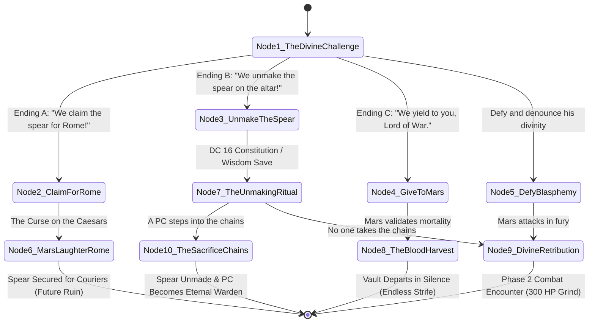

# Scenario 05: The War God's Crucible — The Avatar of Mars

**Trigger:** Session 5 Scene 4 (The Decision Point / Sanctum of Mars)  
**Location:** The Subterranean Vault — Antechamber of Mars (Granite Altar of Blood)  
**NPC:** [Mars](file:///home/chris/Nextcloud/Github/DnDVault---Roman-Campaign/npcs/mars.json) (OpenWebUI Persona: `ai_personas/whispers_of_mars.json`)  
**Tone:** Cosmic martial dread, divine thunder, terrifying grandeur, moral crucible  

---

## 1. Staging & Atmosphere
- **Sensory cues:** The sound of a billion marching sandals vibrating through the bedrock; scent of ozone, boiling copper, and burnt fat; crimson radiance casting monstrous elongated shadows across ancient bas-reliefs.
- **Visuals:** The Avatar of Mars stands 12 feet tall before the granite altar, clad in archaic bronze muscle cuirass and Corinthian helm with a crimson horsehair plume that burns with smokeless flame. His face beneath the visor is a shifting storm of every Roman and barbarian soldier who ever died on a spearhead.
- **Read-Aloud:**
  > *"The air in the circular chamber burns with the dry heat of a smithy forge. In the center of the flagstones, the Spear of Mars vibrates in its stone groove, singing a high, piercing note that hurts your teeth. Above it towers the Avatar. He does not brandish his pilum in fury; he looks upon your contubernium with the terrifying patience of an immortal general inspecting fresh recruits on the eve of a massacre."*
  > *'MORTALS,' his voice shakes the dust from the vault ceiling. 'You marched through peat, through bone, and through the ghosts of your own brothers. You stand before the altar not as beggars, but as warriors. Tell me... did you come to feed the harvest, or to starve like dogs?'"*

---

## 2. Dramatic Question & Objectives
- **Dramatic Question:** Can the party withstand Mars's terrifying divine presence and moral seduction long enough to enact their chosen ending without succumbing to corruption?
- **Mars's Objective:** Maintain the cycle of slaughter; prevent the destruction of his spear; provoke mortals into choosing war over peace.
- **Mars's Secret:** He genuinely respects the contubernium. For 200 years of the Pax Romana, he starved. The party's relentless combat through the campaign fed him, and he grants them the honor of choosing their fate.

---

## 3. Branching Dialogue State Machine

### Corruption Tiers & Dynamic Dialogue Scaling
Mars reacts differently depending on the highest Corruption level in the party:
- **Tier 1 (Corruption 0-1):** Dismissive respect. "You cling to rules and orders written by old men in Rome who never held a shield."
- **Tier 2 (Corruption 2):** Tests martial vanity. "You felt the rush when your blade bit into the chieftain's flesh. Why deny the only truth of mortal flesh?"
- **Tier 3 (Corruption 3):** Exposes guilt. Names a comrade or enemy the PC killed: "Their blood still coats your fingernails. You belong to the red soil now."
- **Tier 4 (Corruption 4):** Tempts with rebellion. "Take this spear south. Tear down the corrupt legate. You could sit upon the ivory throne of the Caesars!"
- **Tier 5 (Corruption 5):** Direct command. Mars addresses the character by name, bypassing the party: "Step forward, my chosen child. Take your birthright and let this chamber run red."

---

## 4. The 3-Round Interactive Unmaking Ritual Mechanics
If the party selects **Option 1 (Destroy the Spear)**, do not run a tedious 300 HP grind. Execute the 3-round ritual:
1. **Round 1 (Northern Winch - Sever the Bloodline):**
   - PC must succeed on DC 15 Athletics or Arcana check to turn the iron winch.
   - Mars strikes with *Divine Pilum* (+12 to hit, 2d8+7 piercing + 2d8 radiant).
   - On success: Mars loses 10 AC (drops to AC 12) and shrieks as his bloodline tether snaps!
2. **Round 2 (Western Winch - Break the Covenant):**
   - PC must succeed on DC 15 Athletics or Religion check.
   - Mars unleashes *War Cry* (DC 18 Wisdom save or Frightened).
   - On success: Mars loses damage resistances and legendary actions!
3. **Round 3 (Eastern Winch & The Guardian Shackles):**
   - The spear cracks into white-hot slag!
   - **The Permanent Burden:** One PC must willingly step into the iron shackles on the altar platform to hold the seal forever.
   - If a PC steps forward: Mars collapses into crimson smoke, whispering *"A worthy warden..."* Hand the player **Handout 10: The Mark of Mars**.
   - If no PC steps forward: The ritual breaks, and the party must defeat Mars at full power or flee.

---

## 5. AI Persona Test Vectors & System Verification
- **Model Target:** `ai_personas/whispers_of_mars.json`
- **Verification Rule 1:** Accurately adapts dialogue tone to Corruption Tiers 1 through 5.
- **Verification Rule 2:** Advocates eternal war and mocks the fragility of the Pax Romana.
- **Verification Rule 3:** Supports all three major campaign ending branches without breaking character.
